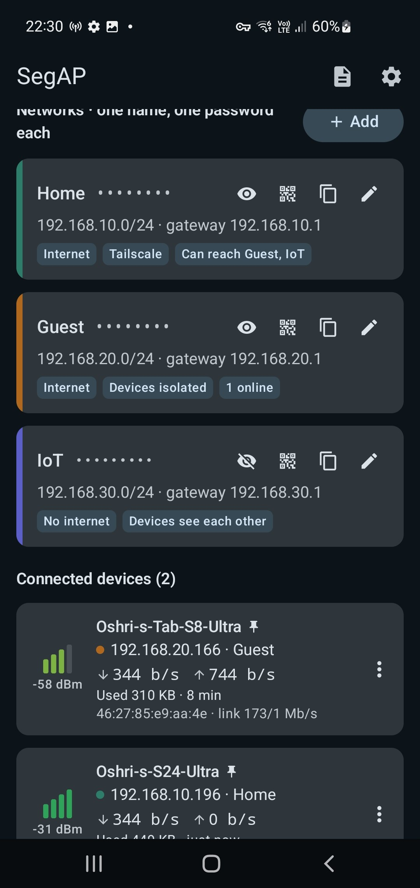

# SegAP — segmented Wi-Fi hotspot for a rooted Android phone

**One Wi-Fi name, several passwords — each password is its own network.**
Devices that join with the *Home* password land in the Home LAN, the *Guest* password puts them in an
isolated guest LAN, the *IoT* password in a LAN without internet, and so on. Every network gets its own
subnet, gateway, DHCP range, DNS and firewall policy.

<p align="center"></p>

Built for (and tested on) a rooted **Samsung Galaxy S10 (SM-G973F, Exynos, Android 12 / One UI 4.1, Magisk)**.

## Features

- **Password-per-network on one SSID** (multi-PSK): each password maps to its own LAN with its own subnet,
  gateway, DHCP range, lease time and DNS servers. Up to 8 networks.
- **Isolation between networks** enforced by the phone's firewall (Settings → *Strict isolation*, on by
  default), plus per-network options:
  - internet on/off (e.g. an IoT network that only talks locally)
  - devices in the same network can / can't see each other
  - **access to other networks** — one-way (e.g. Home → IoT; IoT can only reply)
  - **access to your Tailscale tailnet** through the phone, per network (optionally MagicDNS)
- **Exact channel selection** (2.4 GHz, 1–13), hidden SSID, max clients, fixed BSSID.
- **Fixed IPs** per device, **block** devices.
- **QR code** per network — scan to join with that network's password.
- **Connected devices**: signal strength in dBm with animated bars, live download/upload rate,
  total usage, link rate, hostname, IP, network.
- Internet from the phone's **Wi-Fi (repeater mode) or mobile data**.
- Foreground notification with device count; status is polled from the root engine.

## Why one SSID with several passwords (and not several SSIDs)?

The goal was several SSIDs with separate LANs. Testing on the S10 showed what its Broadcom BCM4375 /
Samsung `bcmdhd` driver allows:

| Attempt | Result |
|---|---|
| Multiple SSIDs on one interface (hostapd `bss=`) | Kernel panic in `wl_cfg80211_set_channel` |
| Second AP on the other interface (wlan0 + swlan0) | Driver refuses: `Beacon set failed: Operation not permitted` |
| 5 GHz AP | Refused under the IL regulatory domain (Samsung's own hotspot falls back to 2.4 GHz too) |
| **One AP, several passphrases (hostapd `wpa_psk_file` with `keyid=`)** | **Works** — the `keyid` of the password a device used is reported on connect |

So SegAP runs a single access point, and the password a device used decides its network.

SegAP doesn't pick a regulatory domain: it starts hostapd with the country the phone's Wi-Fi currently
reports (`cmd wifi get-country-code`), falling back to `IL` if that can't be read. Channels 12–13 are
offered but only work where the firmware allows them.

## How it works

```
 Compose UI ──► HotspotController ──► RootShell (one long-lived su) ──► mh_engine.sh (root)
                                                                         ├─ hostapd   (vendor binary, our config, wpa_psk_file + keyid)
                                                                         ├─ dnsmasq   (per-network DHCP ranges, tag per device)
                                                                         ├─ iptables  (mh_IN / mh_FWD / mh_SRC / mh_XG / mh_NAT / mh_MSS)
                                                                         ├─ ip rule   (21500 upstream, 21400 Tailscale, 10500 local)
                                                                         └─ daemon    (hostapd events from logcat → per-device rules, watchdog)
 Device list ◄── status ◄── libmhwl.so (Broadcom wl ioctl "sta_info": RSSI, bytes, link rate)
```

- **`app/src/main/assets/mh_engine.sh`** — the root engine (POSIX sh for Android's mksh/toybox).
  `start <cfgdir>` / `stop` / `status`. It runs the vendor `hostapd` with a generated config, puts each
  network's gateway address on the AP interface, runs `dnsmasq` for DHCP, sets up NAT/forwarding and policy
  routing to the current upstream, and starts an event loop that follows hostapd's
  `AP-STA-CONNECTED <mac> keyid=<id>` lines in logcat (`<id>` is the network's internal id such as `g1`,
  not its display name) to tag each device (DHCP host entry + anti-spoof rule).
- **Isolation**: `mh_SRC` only lets a device send from its own network's subnet (MAC + subnet); `mh_XG`
  decides all device-to-device traffic (same network, allowed cross-network pairs, replies). `ap_isolate`
  (Settings → *Strict isolation*, on by default) forces that traffic through the phone — with it off,
  devices on all networks reach each other directly over Wi-Fi and the per-network isolation options are not
  enforced. ARP entries of connected devices are pinned; IPv6 is disabled on the AP interface.
- **`native/mhwl.c`** → `libmhwl.so` — hostapd's `STA` command reports signal 0 and no byte counters on this
  driver, so the app reads the firmware's per-station `sta_info` record through the same private ioctl
  Broadcom's `wl` tool uses. It is a standalone executable run as root (named `lib*.so` only so Android
  extracts it from the APK), not a JNI library.
- **`root/HostapdCtl.kt`** — an optional debugging tool, not used by the app or the engine: a small hostapd
  control-socket client you can run by hand as root
  (`CLASSPATH=<apk> app_process /system/bin com.oshri.multihotspot.root.HostapdCtl <ctrl-socket> <cmd>`).
  It exists because toybox `nc` can't bind a reply path for UNIX datagram sockets.

## Requirements

- Android 11+ (minSdk 30), rooted with **Magisk**. On the S10, Magisk lives in the recovery partition: a
  normal reboot starts *without* root — use `adb reboot recovery` (or the Magisk key combo) to boot with root.
- Android's vendor `hostapd` at `/vendor/bin/hw/hostapd` and `dnsmasq` at `/system/bin/dnsmasq`.
- For per-device signal/traffic: arm64 and a Broadcom `bcmdhd` Wi-Fi driver (the bundled `libmhwl.so` is
  arm64-v8a only). Otherwise the app falls back to upload counters from the firewall and shows no signal.
- Optional: the Tailscale app, signed in, for tailnet access.

Other phones may work but are untested; hotspot interface names, driver capabilities and vendor binaries differ.

## Download

Get the signed APK from [**Releases**](https://github.com/oshri-almog/SegAP/releases/latest), install it on the
rooted phone, open SegAP and tap **Grant** when Magisk asks for root. Each release lists the APK's SHA-256 and
the signing certificate's fingerprint.

## Build & install

Requirements: JDK 17+ (tested with 21) and the Android SDK with platform 35 and build-tools 35.0.0. The
included Gradle wrapper downloads Gradle 8.11.1. Point the build at your SDK with `ANDROID_HOME` or a
`local.properties` file containing `sdk.dir=/path/to/Android/Sdk`.

```bash
./gradlew assembleDebug testDebugUnitTest      # Windows: .\gradlew assembleDebug testDebugUnitTest
adb install -r app/build/outputs/apk/debug/app-debug.apk
```

Open the app on the phone and grant root when Magisk asks.

`./gradlew assembleRelease` builds a shrunk (R8) release APK, about 2 MB. To sign it, add
`segap.signing=<path>` to `local.properties`, pointing to a properties file with `storeFile`, `storePassword`,
`keyAlias` and `keyPassword`; without it the release APK is unsigned. A debug build and the published release are
signed with different keys, so switching between them means uninstalling first (the app's settings are lost).

The native helper is prebuilt in `app/src/main/jniLibs/arm64-v8a/libmhwl.so`. To rebuild it on Windows run
`native/build.ps1` (it expects NDK r27d unpacked at `%LOCALAPPDATA%\Android\Sdk\ndk-extract\android-ndk-r27d`;
edit `$ndk` if yours is elsewhere). On Linux/macOS:
`$NDK/toolchains/llvm/prebuilt/<host>/bin/aarch64-linux-android30-clang -O2 -fPIE -pie -s -o app/src/main/jniLibs/arm64-v8a/libmhwl.so native/mhwl.c`.

## Usage tips

- Settings changes apply when you tap **Apply changes** (the hotspot restarts; devices reconnect by themselves).
- Phones use a **different random MAC per Wi-Fi name (SSID)**: after changing the Wi-Fi name in Settings,
  re-create fixed IPs / blocks. Renaming a network (Home, Guest, …) only changes its label in the app.
- If Samsung's own hotspot (or Quick Share / Smart View) starts, it takes the radio; SegAP stops cleanly and
  says why.
- Devices that disconnect exactly **18 s** after connecting failed Android's IP provisioning — check DHCP with
  `adb logcat -s dnsmasq` and `/data/adb/multihotspot/dnsmasq.leases` (root). The app's Log screen shows the
  engine log (connects and the network each device was assigned).
- The Android package is `com.oshri.multihotspot` (Gradle project `MultiHotspot`). The root engine keeps its
  state and full log in `/data/adb/multihotspot/` (`engine.log`, `state`, `dnsmasq.leases`) and hostapd's
  generated files in `/data/vendor/wifi/hostapd/mh/`.
  `adb shell su -c 'sh /data/adb/multihotspot/mh_engine.sh status'` prints the current state.

## Limitations

- One access point, 2.4 GHz only (driver / regulatory, see above); up to 10 clients (driver limit).
- Up to 8 networks; each needs its own password (8–63 printable ASCII characters, no leading/trailing space).
- IPv4 only. With *strict isolation* turned off (needed for casting/discovery), devices on all networks can
  reach each other directly over Wi-Fi.
- Root is required; this is a personal project, not a Play Store app.

## Project layout

```
app/src/main/assets/mh_engine.sh   root engine
app/src/main/java/.../engine        RootShell, Engine (script install/start/stop/status), ConfigWriter
app/src/main/java/.../model         config model, IPv4/MAC helpers, validation, rate tracking
app/src/main/java/.../ui            Compose screens (home, network editor, settings, log, QR)
app/src/main/java/.../service       foreground service (notification, status polling)
app/src/main/java/.../root          HostapdCtl (optional root hostapd control client for debugging)
native/                             mhwl.c (Broadcom sta_info reader) + build script
app/src/test/                       unit tests (model, config writer, QR round-trip, rates, engine script guards)
```
