# SegAP — segmented Wi-Fi hotspot for Android (rooted, or a simpler mode without root)

**One Wi-Fi name, several passwords — each password is its own network.**
Devices that join with the *Home* password land in the Home LAN, the *Guest* password puts them in an
isolated guest LAN, the *IoT* password in a LAN without internet, and so on. Every network gets its own
subnet, gateway, DHCP range, DNS and firewall policy.

<p align="center">
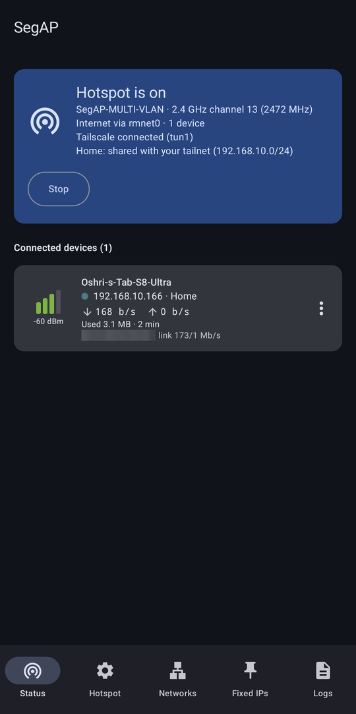
&nbsp;
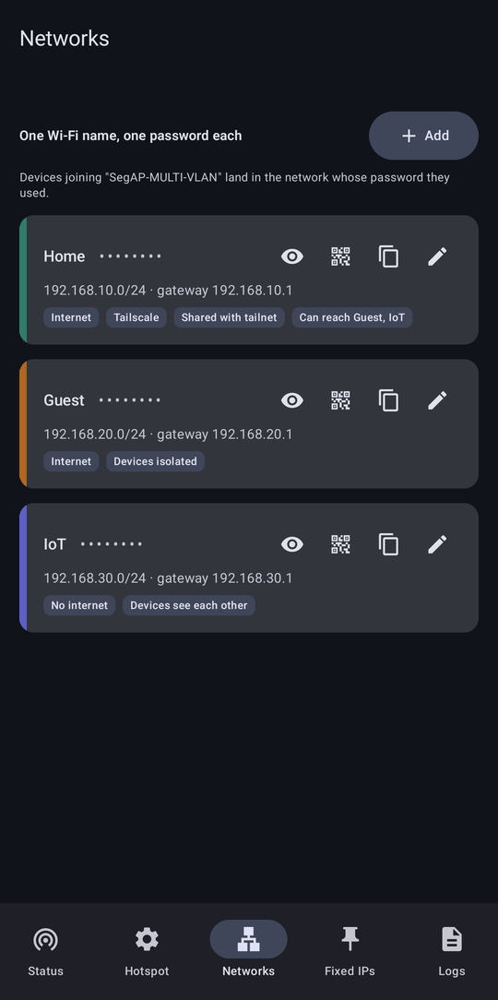
</p>

Built for (and tested on) a rooted **Samsung Galaxy S10 (SM-G973F, Exynos, Android 12 / One UI 4.1, Magisk)**.
Without root, SegAP can still run the phone's own hotspot with one network through Shizuku — see
[Without root](#without-root-the-shizuku-engine).

## Features

- **Password-per-network on one SSID** (multi-PSK): each password maps to its own LAN with its own subnet,
  gateway, DHCP range, lease time and DNS servers. Up to 8 networks.
- **Isolation between networks** enforced by the phone's firewall (Hotspot tab → *Strict isolation*, on by
  default), plus per-network options:
  - internet on/off (e.g. an IoT network that only talks locally)
  - devices in the same network can / can't see each other
  - **access to other networks** — one-way (e.g. Home → IoT; IoT can only reply)
  - **access to your Tailscale tailnet** through the phone, per network (optionally MagicDNS)
- **Per network, its own Tailscale device** (optional, see [below](#tailscale-exit-nodes-and-shared-networks)):
  - **its own exit node** — e.g. Home's internet leaves through a server at home while Guest uses the phone's
    connection, each network with a different exit node;
  - **shared with your tailnet** as a subnet route, so tailnet devices reach the network's devices.
- **Exact channel selection** (2.4 GHz, 1–13), hidden SSID, max clients, fixed BSSID.
- **Fixed IPs** per device, **block** devices.
- **QR code** per network — scan to join with that network's password.
- **Connected devices**: signal strength in dBm with animated bars, live download/upload rate,
  total usage, link rate, hostname, IP, network.
- Internet from the phone's **Wi-Fi (repeater mode) or mobile data**.
- Full-screen app with five tabs: **Status** (hotspot and devices), **Hotspot** settings, **Networks**,
  **Fixed IPs** & blocked devices, **Logs**.
- Foreground notification with device count; status is polled from the engine.
- **Two engines**: root (everything above) or, without root, [Shizuku](#without-root-the-shizuku-engine)
  (the phone's own hotspot, one network; root-only settings are greyed out).

## Screenshots

From the Galaxy S10 with the root engine (for the no-root mode see [Without root](#without-root-the-shizuku-engine),
for Tailscale [below](#tailscale-exit-nodes-and-shared-networks)). MAC addresses and tailnet addresses are
blurred, and the QR code is replaced by a sample.

<table>
<tr>
<td align="center" valign="top" width="33%"><br><sub><b>Status</b> — hotspot, internet source, Tailscale, connected devices with signal and live traffic</sub></td>
<td align="center" valign="top" width="33%">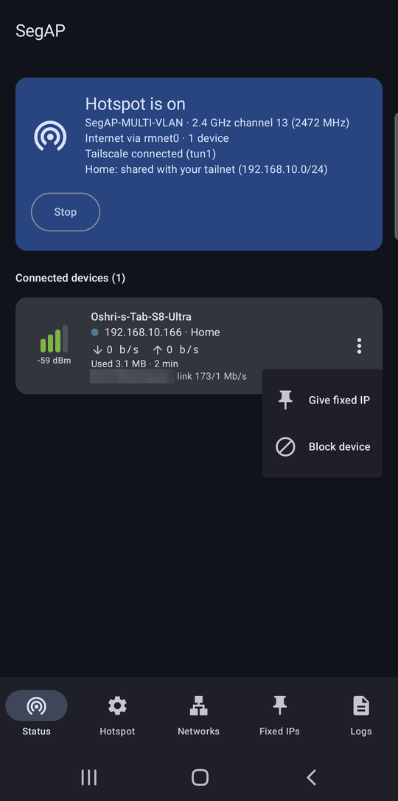<br><sub>Device actions: give it a fixed IP, or block it</sub></td>
<td align="center" valign="top" width="33%"><br><sub><b>Networks</b> — one password each: show, QR code, copy, edit</sub></td>
</tr>
<tr>
<td align="center" valign="top" width="33%">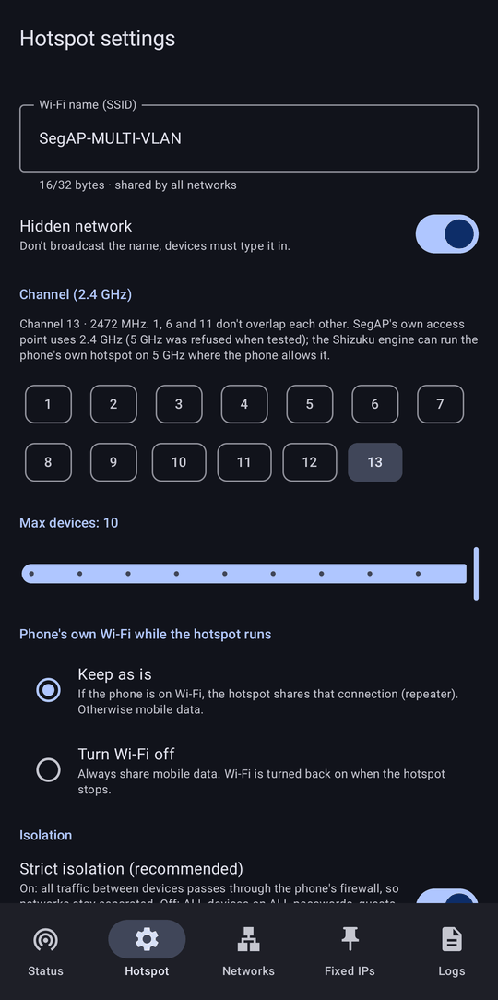<br><sub><b>Hotspot</b> — Wi-Fi name, hidden, channel, max devices, the phone's own Wi-Fi</sub></td>
<td align="center" valign="top" width="33%">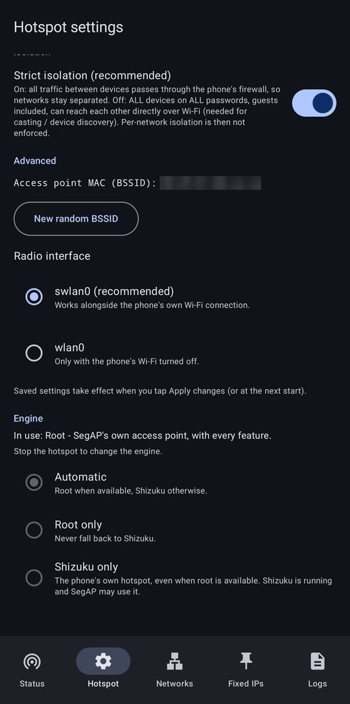<br><sub>Strict isolation, BSSID, radio interface, and the engine (root / Shizuku)</sub></td>
<td align="center" valign="top" width="33%">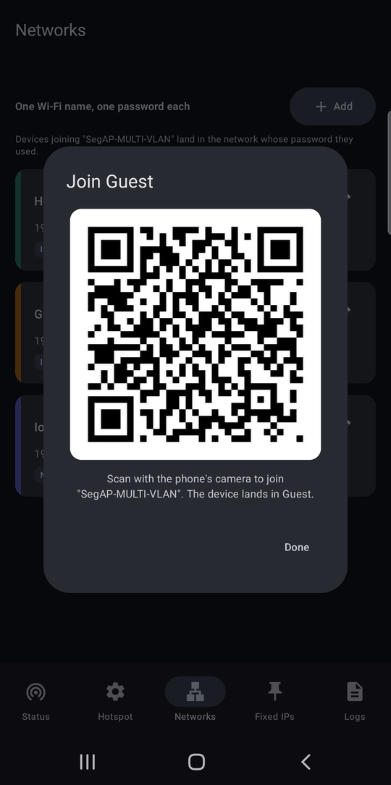<br><sub>QR code to join a network (a sample code here: the real one holds the password)</sub></td>
</tr>
<tr>
<td align="center" valign="top" width="33%">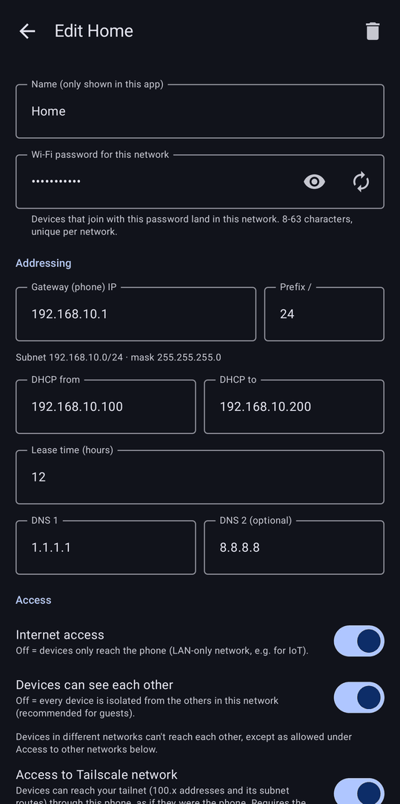<br><sub>Network editor — password and addressing: gateway, DHCP range, lease time, DNS</sub></td>
<td align="center" valign="top" width="33%">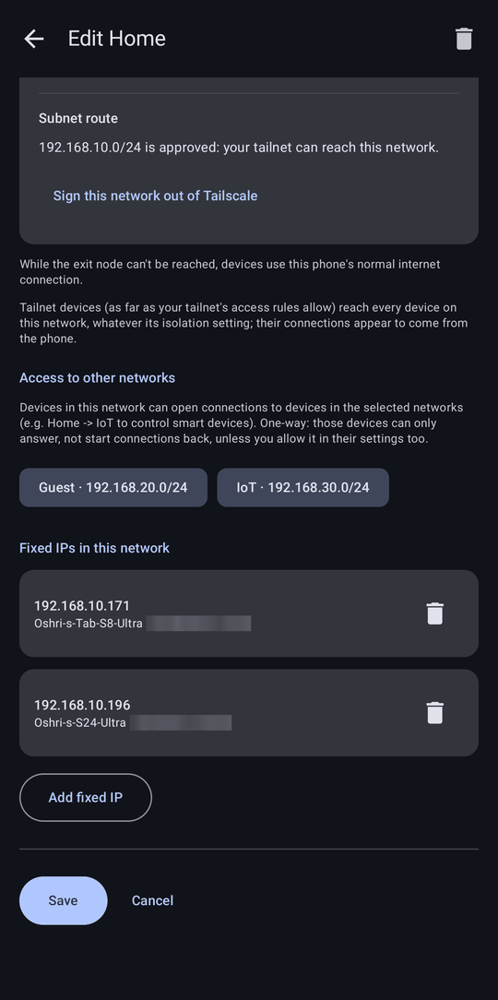<br><sub>Access to other networks, and the network's fixed IPs</sub></td>
<td align="center" valign="top" width="33%">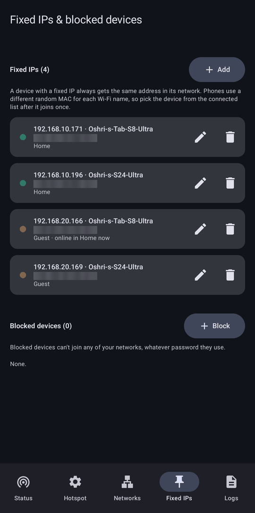<br><sub><b>Fixed IPs</b> & blocked devices of all networks</sub></td>
</tr>
<tr>
<td align="center" valign="top" width="33%">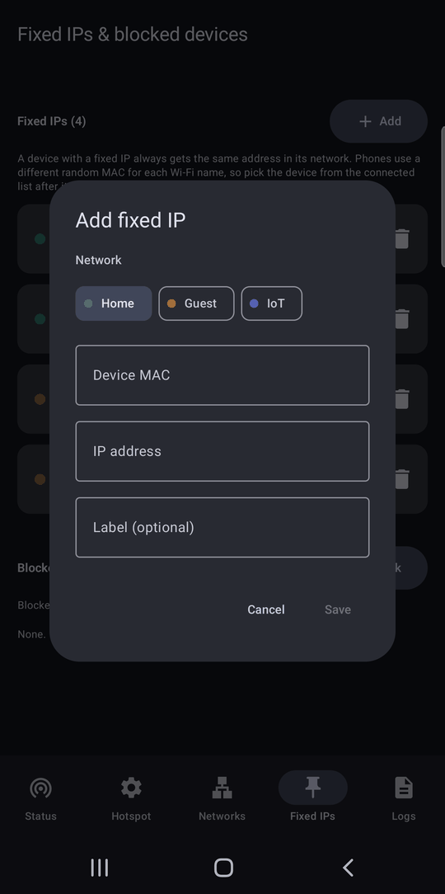<br><sub>Adding a fixed IP: network, device MAC, address</sub></td>
<td align="center" valign="top" width="33%">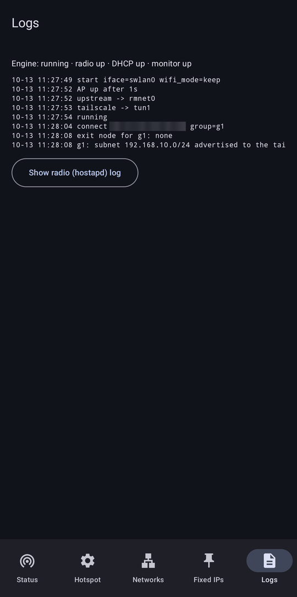<br><sub><b>Logs</b> — engine state and log; the radio log on request</sub></td>
<td></td>
</tr>
</table>

## Why one SSID with several passwords (and not several SSIDs)?

The goal was several SSIDs with separate LANs. Testing on the S10 showed what its Broadcom BCM4375 /
Samsung `bcmdhd` driver allows:

| Attempt | Result |
|---|---|
| Multiple SSIDs on one interface (hostapd `bss=`) | Kernel panic in `wl_cfg80211_set_channel` |
| Second AP on the other interface (wlan0 + swlan0) | Driver refuses: `Beacon set failed: Operation not permitted` |
| 5 GHz AP (SegAP's own) | Refused when tested under the IL regulatory domain. The phone's own hotspot does run on 5 GHz (channel 149), which the [Shizuku engine](#without-root-the-shizuku-engine) can use |
| **One AP, several passphrases (hostapd `wpa_psk_file` with `keyid=`)** | **Works** — the `keyid` of the password a device used is reported on connect |

So SegAP runs a single access point, and the password a device used decides its network.

SegAP doesn't pick a regulatory domain: it starts hostapd with the country the phone's Wi-Fi currently
reports (`cmd wifi get-country-code`), falling back to `IL` if that can't be read. Channels 12–13 are
offered but only work where the firmware allows them.

## How it works

```
 Compose UI ──► HotspotController ──► RootShell (one long-lived su) ──► mh_engine.sh (root)
                                                                         ├─ hostapd   (vendor binary, our config, wpa_psk_file + keyid)
                                                                         ├─ dnsmasq   (per-network DHCP ranges, tag per device)
                                                                         ├─ iptables  (mh_IN / mh_FWD / mh_SRC / mh_XG / mh_NAT / mh_MSS)
                                                                         ├─ ip rule   (21500 upstream, 21400 Tailscale, 10500 local)
                                                                         └─ daemon    (hostapd events from logcat → per-device rules, watchdog)
 Device list ◄── status ◄── libmhwl.so (Broadcom wl ioctl "sta_info": RSSI, bytes, link rate)
```

- **`app/src/main/assets/mh_engine.sh`** — the root engine (POSIX sh for Android's mksh/toybox).
  `start <cfgdir>` / `stop` / `status`. It runs the vendor `hostapd` with a generated config, puts each
  network's gateway address on the AP interface, runs `dnsmasq` for DHCP, sets up NAT/forwarding and policy
  routing to the current upstream, and starts an event loop that follows hostapd's
  `AP-STA-CONNECTED <mac> keyid=<id>` lines in logcat (`<id>` is the network's internal id such as `g1`,
  not its display name) to tag each device (DHCP host entry + anti-spoof rule).
- **Isolation**: `mh_SRC` only lets a device send from its own network's subnet (MAC + subnet); `mh_XG`
  decides all device-to-device traffic (same network, allowed cross-network pairs, replies). `ap_isolate`
  (Hotspot tab → *Strict isolation*, on by default) forces that traffic through the phone — with it off,
  devices on all networks reach each other directly over Wi-Fi and the per-network isolation options are not
  enforced. ARP entries of connected devices are pinned; IPv6 is disabled on the AP interface.
- **`native/mhwl.c`** → `libmhwl.so` — hostapd's `STA` command reports signal 0 and no byte counters on this
  driver, so the app reads the firmware's per-station `sta_info` record through the same private ioctl
  Broadcom's `wl` tool uses. It is a standalone executable run as root (named `lib*.so` only so Android
  extracts it from the APK), not a JNI library.
- **Per-network Tailscale instances** — see the next section.
- **`root/HostapdCtl.kt`** — an optional debugging tool, not used by the app or the engine: a small hostapd
  control-socket client you can run by hand as root
  (`CLASSPATH=<apk> app_process /system/bin com.oshri.multihotspot.root.HostapdCtl <ctrl-socket> <cmd>`).
  It exists because toybox `nc` can't bind a reply path for UNIX datagram sockets.

## Tailscale: exit nodes and shared networks

Two ways to use Tailscale:

- **Access to Tailscale network** (per network): devices reach your tailnet through the **Tailscale app** on
  the phone, as if they were the phone.
- **Tailscale for this network** (per network): SegAP runs a **separate Tailscale device for that network**
  (`segap-<network name>` in your tailnet). The Tailscale app holds one exit node for the whole phone, so this
  is what lets every network have its own:
  - **exit node** — the network's internet leaves through the chosen tailnet device. While that node can't be
    used (offline, no longer offered as an exit node, or the network's Tailscale isn't connected), the network
    falls back to the phone's normal connection. Exit-node networks need public DNS servers, and can't reach
    private addresses behind the exit node (its LAN, subnet routes) or the tailnet itself.
  - **sharing with the tailnet** — the network's subnet is advertised as a subnet route. Approve it once in the
    admin console (Machines → `segap-…` → Edit route settings, or with `autoApprovers`). Tailnet devices then
    reach the network's devices (whatever its isolation setting; connections appear to come from the phone),
    but never the phone itself.

How it works: the first time, the app downloads the official static Tailscale package for Linux
(`tailscale_1.104.1_arm64.tgz` from pkgs.tailscale.com, about 38 MB, checked against a pinned SHA-256) and
the engine installs it to `/data/adb/multihotspot/ts/bin`. Each such network gets its own `tailscaled` in its
own network namespace, joined to the phone by a veth pair (`sg<N>` ↔ `198.18.<N>.0/30`), so Tailscale's
usual routing rules never touch Android's. The engine routes the network into it (`ip rule` 21450 → table
`60000+N`) only while its exit node is usable, and the watchdog restarts instances, follows upstream changes
and switches back and forth automatically. Sign-in happens in the network editor (link or QR code); the login
is kept in `/data/adb/multihotspot/ts/<network>/`. Deleting the network signs its device out.

<table>
<tr>
<td align="center" valign="top" width="33%">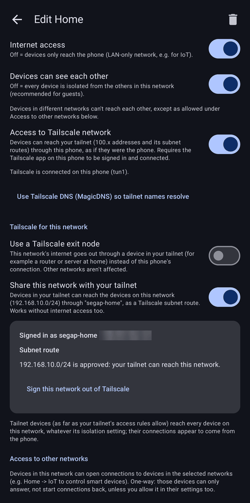<br><sub>Per network: access to the tailnet, and the network's own Tailscale device sharing its subnet</sub></td>
<td align="center" valign="top" width="33%">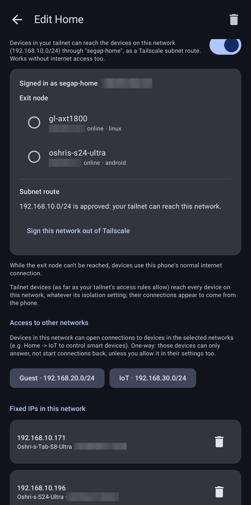<br><sub>Choosing the network's exit node from your tailnet's exit nodes</sub></td>
<td></td>
</tr>
</table>

Tailscale is © Tailscale Inc. & contributors, BSD-3-Clause (https://github.com/tailscale/tailscale); SegAP
doesn't redistribute it, the app downloads the official package.

## Without root: the Shizuku engine

Without root, SegAP drives the phone's **own hotspot** through [Shizuku](https://shizuku.rikka.app/), which
gives apps the rights of `adb shell`. That is enough to set the hotspot's name, password, band and channel and to
start and stop it, but not to run SegAP's own access point, DHCP server or firewall. So with Shizuku:

| | Root engine | Shizuku engine |
|---|---|---|
| Networks | up to 8 passwords, a LAN each | one: the first network's password |
| Addresses, DHCP range, DNS, lease time | per network | chosen by Android |
| Internet on/off, access between networks, strict isolation | yes | — |
| Devices can't see each other | yes | if the phone's hotspot supports it (Samsung: yes) |
| Max devices | yes | if the phone's hotspot supports it (Samsung: yes) |
| Block devices | yes | only with driver support for client control (not on the S10 or S24) |
| Fixed IPs | yes | — |
| Tailscale (access, exit nodes, sharing) | yes | — |
| Band | 2.4 GHz | 2.4 or 5 GHz, where the phone allows it |
| Device list | signal, traffic, link rate | name, IP, time connected |

Root-only settings stay visible but greyed out, with the reason, and are kept for when root is available.
Screenshots from the Galaxy S10 with the Shizuku engine:

<table>
<tr>
<td align="center" valign="top" width="33%">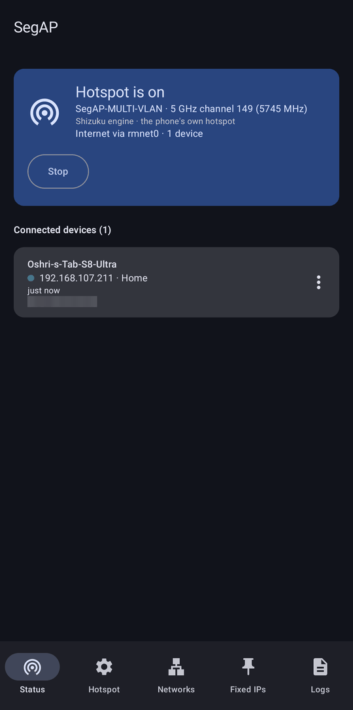<br><sub>Status: the phone's own hotspot, here on 5 GHz; devices with name, IP and time connected</sub></td>
<td align="center" valign="top" width="33%">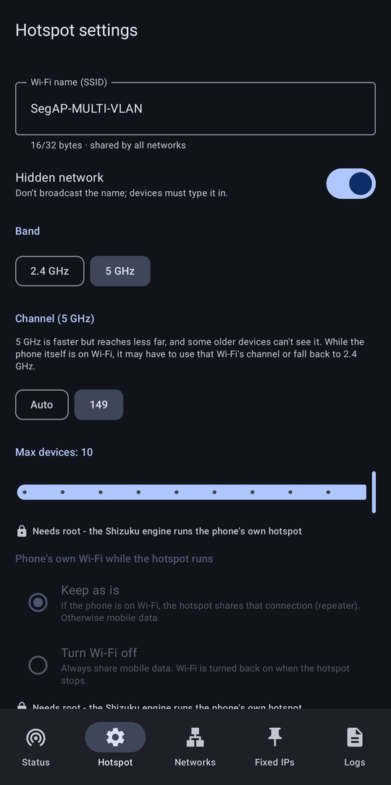<br><sub>Band and channel (2.4 / 5 GHz) and max devices; root-only settings greyed out</sub></td>
<td align="center" valign="top" width="33%">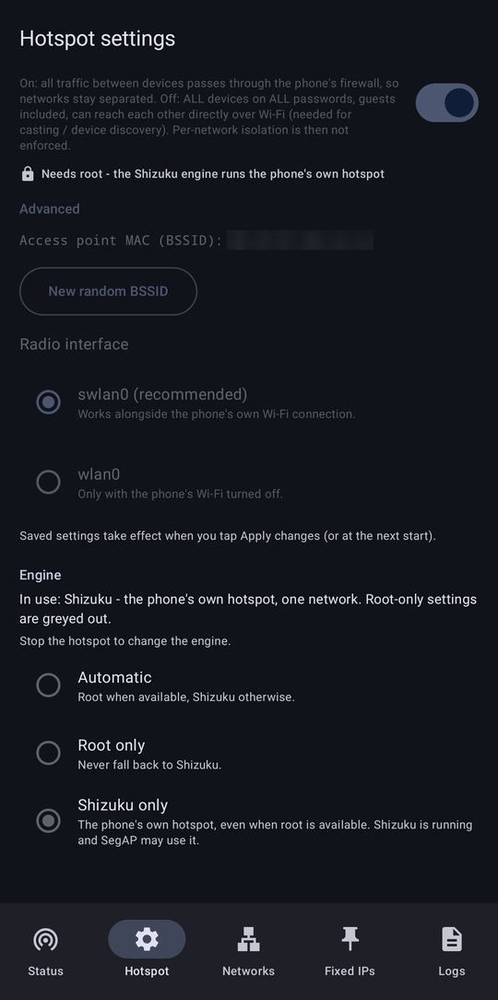<br><sub>The engine choice; isolation, BSSID and radio settings need root</sub></td>
</tr>
<tr>
<td align="center" valign="top" width="33%">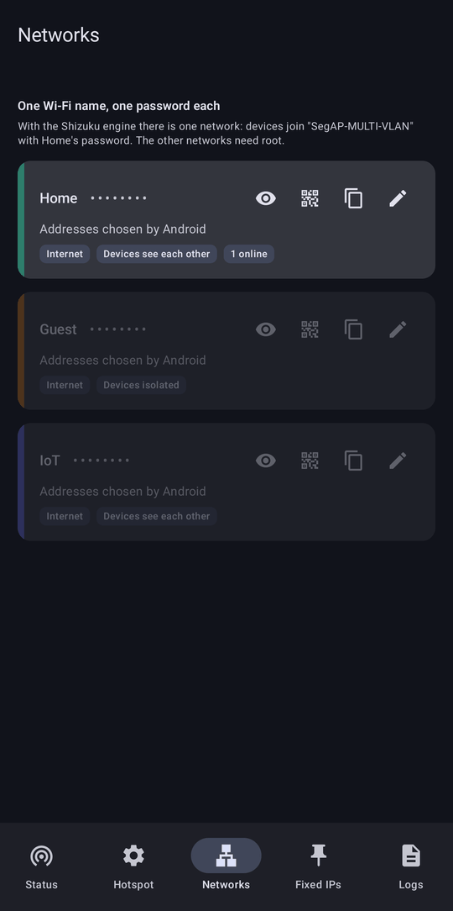<br><sub>Only the first network is used; the others need root</sub></td>
<td align="center" valign="top" width="33%">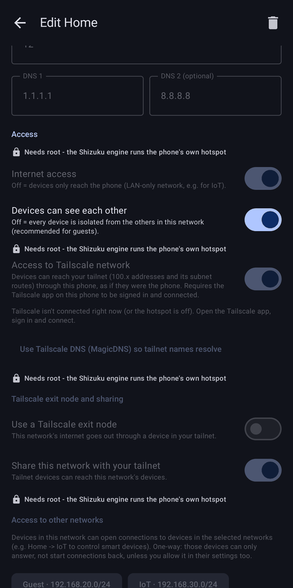<br><sub>In the network editor, what needs root is greyed out with the reason</sub></td>
<td align="center" valign="top" width="33%">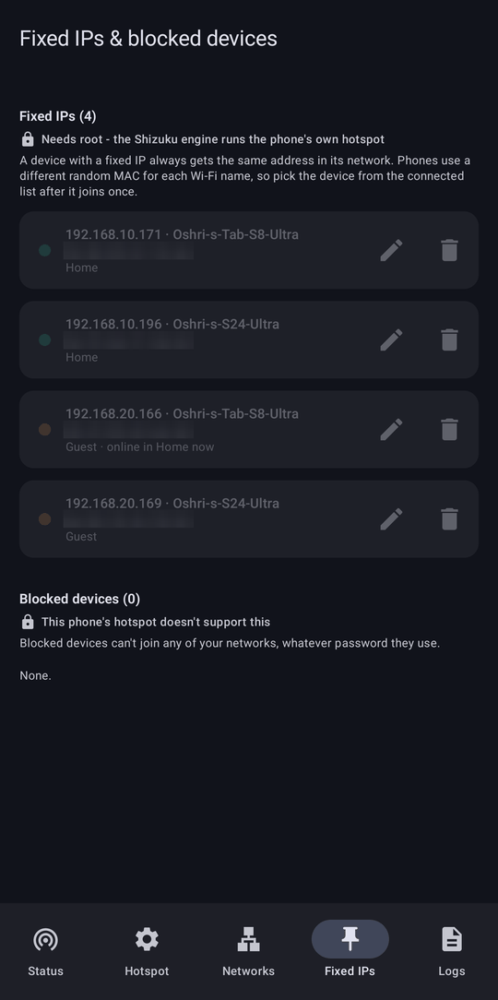<br><sub>Fixed IPs need root; blocking needs the phone's hotspot to support it</sub></td>
</tr>
</table>

Setup: install Shizuku and start it (with wireless debugging on Android 11+, or over `adb`; again after every
reboot), then open SegAP and tap **Allow SegAP in Shizuku**. The **Engine** setting at the bottom of the Hotspot
tab picks **Automatic** (root when available, Shizuku otherwise — the default), **Root only** or **Shizuku
only**; it can be changed while the hotspot is off.

- Starting the hotspot from SegAP replaces the phone's own hotspot settings (name, password, band) with SegAP's.
- While the phone itself is on Wi-Fi, its hotspot may have to use that Wi-Fi's channel or fall back to 2.4 GHz;
  the Status tab shows the band actually in use.
- How it works: Shizuku runs `shizuku/HotspotCore.kt` in its own process with the shell user's rights
  (uid 2000). It sets the configuration through Android's `WifiManager` (and Samsung's Wi-Fi service when
  present, for max devices and isolation) and starts tethering through `TetheringManager`.
- Tested on the S10 (Android 12) and a Galaxy S24 Ultra (Android 16 / One UI 8.5).

## Requirements

- Android 11+ (minSdk 30), rooted with **Magisk**. On the S10, Magisk lives in the recovery partition: a
  normal reboot starts *without* root — use `adb reboot recovery` (or the Magisk key combo) to boot with root.
  Without root: [Shizuku](#without-root-the-shizuku-engine), with fewer features.
- Android's vendor `hostapd` at `/vendor/bin/hw/hostapd` and `dnsmasq` at `/system/bin/dnsmasq`.
- For per-device signal/traffic: arm64 and a Broadcom `bcmdhd` Wi-Fi driver (the bundled `libmhwl.so` is
  arm64-v8a only). Otherwise the app falls back to upload counters from the firewall and shows no signal.
- Optional: the Tailscale app, signed in, for "Access to Tailscale network". Per-network exit nodes and shared
  networks need an arm64 phone and internet access for the one-time download, not the Tailscale app.

Other phones may work but are untested; hotspot interface names, driver capabilities and vendor binaries differ.

## Download

Get the signed APK from [**Releases**](https://github.com/oshri-almog/SegAP/releases/latest), install it on the
rooted phone, open SegAP and tap **Grant** when Magisk asks for root (without root, see
[Shizuku](#without-root-the-shizuku-engine)). Each release lists the APK's SHA-256 and the signing certificate's
fingerprint.

## Build & install

Requirements: JDK 17+ (tested with 21) and the Android SDK with platform 35 and build-tools 35.0.0. The
included Gradle wrapper downloads Gradle 8.11.1. Point the build at your SDK with `ANDROID_HOME` or a
`local.properties` file containing `sdk.dir=/path/to/Android/Sdk`.

```bash
./gradlew assembleDebug testDebugUnitTest      # Windows: .\gradlew assembleDebug testDebugUnitTest
adb install -r app/build/outputs/apk/debug/app-debug.apk
```

Open the app on the phone and grant root when Magisk asks.

`./gradlew assembleRelease` builds a shrunk (R8) release APK, about 2 MB. To sign it, add
`segap.signing=<path>` to `local.properties`, pointing to a properties file with `storeFile`, `storePassword`,
`keyAlias` and `keyPassword`; without it the release APK is unsigned. A debug build and the published release are
signed with different keys, so switching between them means uninstalling first (the app's settings are lost).

The native helper is prebuilt in `app/src/main/jniLibs/arm64-v8a/libmhwl.so`. To rebuild it on Windows run
`native/build.ps1` (it expects NDK r27d unpacked at `%LOCALAPPDATA%\Android\Sdk\ndk-extract\android-ndk-r27d`;
edit `$ndk` if yours is elsewhere). On Linux/macOS:
`$NDK/toolchains/llvm/prebuilt/<host>/bin/aarch64-linux-android30-clang -O2 -fPIE -pie -s -o app/src/main/jniLibs/arm64-v8a/libmhwl.so native/mhwl.c`.

## Usage tips

- Changes apply when you tap **Apply changes** (on any tab while the hotspot runs; the hotspot restarts and
  devices reconnect by themselves).
- Phones use a **different random MAC per Wi-Fi name (SSID)**: after changing the Wi-Fi name in the Hotspot tab,
  re-create fixed IPs / blocks. Renaming a network (Home, Guest, …) only changes its label in the app
  (and the name of its Tailscale device, if it has one).
- If Samsung's own hotspot (or Quick Share / Smart View) starts, it takes the radio; SegAP stops cleanly and
  says why.
- Devices that disconnect exactly **18 s** after connecting failed Android's IP provisioning — check DHCP with
  `adb logcat -s dnsmasq` and `/data/adb/multihotspot/dnsmasq.leases` (root). The app's Logs tab shows the
  engine log (connects and the network each device was assigned).
- The Android package is `com.oshri.multihotspot` (Gradle project `MultiHotspot`). The root engine keeps its
  state and full log in `/data/adb/multihotspot/` (`engine.log`, `state`, `dnsmasq.leases`) and hostapd's
  generated files in `/data/vendor/wifi/hostapd/mh/`.
  `adb shell su -c 'sh /data/adb/multihotspot/mh_engine.sh status'` prints the current state.

## Limitations

- Root engine: one access point, 2.4 GHz only (5 GHz was refused when tested, see above; the Shizuku engine can use
  5 GHz where the phone allows it); up to 10 clients (driver limit).
- Up to 8 networks; each needs its own password (8–63 printable ASCII characters, no leading/trailing space).
- IPv4 only. With *strict isolation* turned off (needed for casting/discovery), devices on all networks can
  reach each other directly over Wi-Fi.
- Without root only the Shizuku engine's subset works (see above). This is a personal project, not a Play Store
  app.

## Project layout

```
app/src/main/assets/mh_engine.sh   root engine
app/src/main/java/.../engine        HotspotBackend (root / Shizuku engines and their capabilities), RootShell, Engine
                                    (script install/start/stop/status, Tailscale instances), ConfigWriter,
                                    TailscalePackage (pinned download), ShizukuBackend / ShizukuSupport
app/src/main/java/.../shizuku       HotspotUserService + HotspotCore (the phone's hotspot, run as shell by Shizuku)
app/src/main/aidl/                  IHotspotService (app <-> Shizuku service)
app/src/main/java/.../model         config model, IPv4/MAC helpers, validation, rate tracking
app/src/main/java/.../ui            Compose screens (tabs: status, hotspot, networks, fixed IPs, logs; network editor; QR)
app/src/main/java/.../service       foreground service (notification, status polling)
app/src/main/java/.../root          HostapdCtl (optional root hostapd control client for debugging)
native/                             mhwl.c (Broadcom sta_info reader) + build script
app/src/test/                       unit tests (model, config writer, QR round-trip, rates, engine script guards, Shizuku engine)
```
